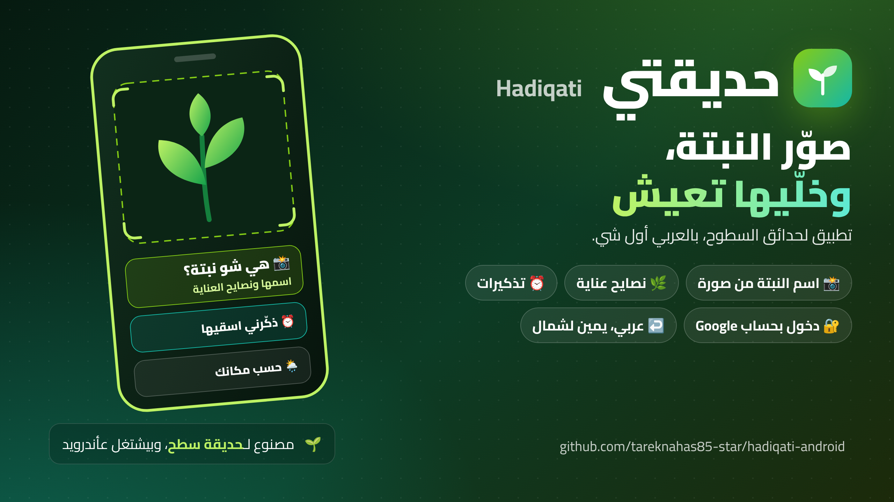

# Hadiqati (حديقتي)

**An Android app for rooftop gardens: snap a plant, find out what it is, and get reminded to look after it.**
**تطبيق أندرويد لحدائق السطوح: صوّر النبتة، اعرف شو هي، وبيذكّرك تعتني فيها.**



**[⬇️ Download latest APK](https://github.com/tareknahas85-star/hadiqati-android/releases/download/latest/hadiqati.apk)** &nbsp;|&nbsp; **[⬇️ حمّل آخر نسخة APK](https://github.com/tareknahas85-star/hadiqati-android/releases/download/latest/hadiqati.apk)**

[English](#in-english) &nbsp;·&nbsp; [بالعربي](#بالعربي)

> **Keys:** to identify plants, the app asks you to enter your own Plant.id and Google Gemini API keys inside the app.
> **المفاتيح:** عشان يتعرّف عالنباتات، التطبيق بيطلب منك تدخل مفاتيح Plant.id وGoogle Gemini الخاصة فيك جوا التطبيق.

## Download · التحميل

| 📘 Guide · الدليل | 📱 App · التطبيق |
|---|---|
| [⬇️ Interactive guide · الدليل التفاعلي](https://github.com/tareknahas85-star/hadiqati-android/releases/download/v1.0.0/Hadiqati-Guide.html) | [⬇️ hadiqati.apk](https://github.com/tareknahas85-star/hadiqati-android/releases/download/latest/hadiqati.apk) |

📘 **Start here:** the interactive guide is one HTML file that works offline on any device. Download it and open it in any browser.
📘 **ابدأ من هون:** الدليل التفاعلي ملف واحد بيشتغل بلا نت على أي جهاز. نزّلو وافتحو بأي متصفح.

The app is a debug build for trying out. The guide's checksum is in `SHA256SUMS.txt` on the [guide release](https://github.com/tareknahas85-star/hadiqati-android/releases/tag/v1.0.0).
التطبيق نسخة تجريبية (debug) للتجربة. الـchecksum تبع الدليل بملف `SHA256SUMS.txt` بـ[صفحة إصدار الدليل](https://github.com/tareknahas85-star/hadiqati-android/releases/tag/v1.0.0).

## Videos · الفيديوهات

🎬 Watch the whole thing on YouTube (made with AI help, Shami voice) · شوف كل شي عاليوتيوب (معمول بمساعدة الذكاء الاصطناعي، وصوت شامي):

- ▶️ [Full walkthrough · الشرح الكامل](https://www.youtube.com/playlist?list=PLZdO7ODf-1TU)
- 📺 [Step by step · خطوة بخطوة](https://www.youtube.com/playlist?list=PLFeR9aold_Xg)

---

## In English

An Android app for rooftop gardens. Take a photo of a plant and the app tells you what it is, gives you care tips, and reminds you when to water it. The app is in Arabic first, and works right to left.

### What it does

- Tells you the name of a plant from a photo you take
- Gives care tips based on where you live
- Sends you reminders to take care of your plants
- Sign in with your Google account
- Arabic screens, right to left

### What you need

Permissions on the phone: camera, location, and notifications (on Android 13 or newer).

### How to build it

**With GitHub Actions (easier):** push your changes to the repo, and the app file is published on the [releases page](https://github.com/tareknahas85-star/hadiqati-android/releases/tag/latest).

**On your computer:**

```bash
gradle assembleDebug
```

The app file comes out at `app/build/outputs/apk/debug/app-debug.apk`.

### How it works

The app is a small Android shell written in Kotlin. Inside it, it opens the Hadiqati page from files bundled inside the app (`file:///android_asset/index.html`). The shell adds the parts the page cannot do alone: taking the photo with the camera, making the photo smaller before sending it, reading your location, and showing reminders.

---

## بالعربي

تطبيق أندرويد لحدائق السطوح. صوّر النبتة والتطبيق بيقلك شو هي، وبيعطيك نصايح للعناية فيها، وبيذكّرك متى تسقيها. التطبيق بالعربي أول شي، وبيشتغل من اليمين لليسار.

### شو بيعمل

- بيقلك اسم النبتة من صورة بتلتقطها
- بيعطيك نصايح عناية حسب المكان اللي ساكن فيه
- بيبعتلك تذكيرات منشان تعتني بنباتاتك
- تسجيل دخول بحساب Google
- شاشات عربية، من اليمين لليسار

### شو بتحتاج

صلاحيات عالتلفون: الكاميرا، والموقع، والإشعارات (عأندرويد 13 أو أحدث).

### كيف بتبنيه

**عبر GitHub Actions (الأسهل):** ارفع تعديلاتك عالريبو، وملف التطبيق بيننشر بـ[صفحة الإصدارات](https://github.com/tareknahas85-star/hadiqati-android/releases/tag/latest).

**عجهازك:**

```bash
gradle assembleDebug
```

ملف التطبيق بيطلع بـ `app/build/outputs/apk/debug/app-debug.apk`.

### كيف بيشتغل

التطبيق عبارة عن غلاف أندرويد صغير مكتوب بـ Kotlin. وجواتو بيفتح صفحة حديقتي من ملفات داخلية مضمّنة بالتطبيق (`file:///android_asset/index.html`). الغلاف بيضيف الشغلات اللي الصفحة ما بتقدر تعملها لحالها: التقاط الصورة بالكاميرا، وتصغير الصورة قبل ما تنبعت، وقراءة موقعك، وعرض التذكيرات.


## Contribute · ساهم معنا

Want to help? Read [CONTRIBUTING.md](CONTRIBUTING.md). Issues labelled [`good first issue`](../../labels/good%20first%20issue) are an easy start, and questions or ideas are welcome in [Discussions](../../discussions).

بدك تساعد؟ اقرا [CONTRIBUTING.md](CONTRIBUTING.md). المهام اللي عليها [`good first issue`](../../labels/good%20first%20issue) بداية سهلة، وأي سؤال أو فكرة احكيها بـ [Discussions](../../discussions).
